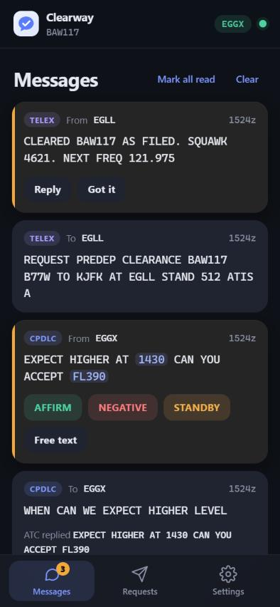
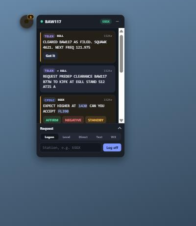

# Clearway

**CPDLC for VATSIM on your iPhone and inside Microsoft Flight Simulator.** Free, no accounts, no Mac needed.

Clearway is a small companion program for Windows that connects to the [Hoppie ACARS](https://www.hoppie.nl/acars/) network. It lets you read and answer CPDLC messages from:

- 📱 **your iPhone**: a clean web app on your home screen, plus lock-screen notifications through the free [ntfy](https://ntfy.sh) app
- ✈️ **an in-game MSFS toolbar panel**: a small floating icon you can put anywhere on screen. It flashes when a message arrives and stays amber until you answer.

You can use both at the same time; they stay in sync.

<p>
  
  &nbsp;
  
</p>

## Features

- CPDLC logon and logoff, automatic handover to the next station
- One-tap answers: **WILCO / UNABLE / STANDBY**, **AFFIRM / NEGATIVE**, **ROGER**, or free text
- Requests: level, direct to, speed, "when can we expect…", free text
- Pre-departure clearance (PDC/DCL), oceanic clearance request and telex, from the phone and the MSFS panel
- METAR, TAF and VATSIM ATIS lookups
- Automatic ADS-C position reports, using the sim's position when the panel is open and VATSIM data otherwise
- Phone notifications with quick-reply buttons
- Optionally mutes phone notifications while the MSFS panel is open
- Callsign and flight plan read automatically from VATSIM using your CID
- Collapse messages to one line, delete them, and restore deleted ones (until Clearway quits)
- Dark theme by default, with a light theme in Settings that also applies to the MSFS panel
- Runs quietly as a tray icon with no console window

## How it works

```
 Hoppie ACARS  ◄──►  Clearway (your PC)  ◄──►  MSFS panel  (localhost)
                         │      ▲
                         │      └──────────►  iPhone web app (home Wi-Fi)
                         └──► ntfy.sh ─────►  iPhone lock-screen notifications
```

Only the companion talks to Hoppie, so the phone and the panel never compete for messages. Your Hoppie logon code stays on your PC. Notifications contain only the message text.

## Setup

### 1. The companion (Windows)

1. Download `Clearway.exe` from the [Releases](../../releases) page and run it. There is no window: Clearway runs as an icon in the notification area next to the clock. **Double-click** the icon to open it; **right-click** it to connect, disconnect or quit. Keep it running while you fly.
2. Windows Firewall will ask about network access. Allow **Private networks**, so your phone can reach it.
3. The first time, your browser opens on `http://localhost:8787` (later, double-click the tray icon). Go to **Settings** and enter:
   - your **Hoppie logon code** (get one free at [hoppie.nl/acars](https://www.hoppie.nl/acars/system/register.html))
   - your **VATSIM CID**
4. Connect to VATSIM with your pilot client, then press **Connect**.

### 2. Your iPhone

1. Make sure the phone is on the same Wi-Fi as the PC.
2. In Clearway on the PC, open **Settings** and scan the **Pair your iPhone** QR code with the iPhone camera.
3. In Safari, tap **Share → Add to Home Screen**.
4. For notifications, install **ntfy** from the App Store (free, no account). Tap **+** and subscribe to the topic shown in Clearway's Settings. Press **Send test** to check.

> Notifications arrive anywhere, but replying from the phone needs your home Wi-Fi.

### 3. The MSFS panel (optional)

1. Download `clearway-panel.zip` from the Releases page.
2. Unzip it into your MSFS **Community** folder.
3. In the sim, click the Clearway icon in the toolbar. A small round icon appears:
   - **click** it to open or collapse the message card
   - **drag** it anywhere on screen (the position is remembered)
   - it **flashes** when a message arrives and **stays amber** until you answer or acknowledge it

The panel is a transparent full-screen layer, and only the icon and card catch the mouse. It's designed for 16:9 screens (1080p, 1440p, 4K).

## Using it

1. In **Requests → ATC logon**, enter the station (e.g. `EGGX`, `CZQX`, `KZNY`) and press **Log on**.
2. Messages from ATC appear with answer buttons. Answer from the phone, the panel, or straight from the notification.
3. Tap a message without answer options to acknowledge it.

## Building from source

The companion needs Python 3.11+ with only the standard library. To run it:

```bash
cd companion
python clearway_app.py
```

Or double-click `companion/Clearway.pyw` to run it from source with only the tray icon, no console window.

To test without the real network, run against a fake Hoppie server:

```bash
python tools/dev_run.py
```

To build the exe:

```bash
pip install pyinstaller
cd companion
pyinstaller --onefile --name Clearway --noconsole --icon web/clearway.ico --add-data "web;web" clearway_app.py
```

For the MSFS panel you need the free MSFS SDK. The SDK's package tool briefly starts the sim to compile the panel:

```bash
python tools/build_panel.py --install
```

The compiled panel definition is cached in `msfs-panel/compiled/`. Commit it, so GitHub Actions can package releases without the SDK.

Releases are built by GitHub Actions when you push a tag such as `v0.1.0`.

## Project layout

```
companion/            Python companion (no third-party packages)
  clearway/           Hoppie client, CPDLC session, ntfy, web server
  web/                phone and desktop web app
msfs-panel/           MSFS toolbar panel package sources
tools/                build scripts, icon generator, mock Hoppie server
```

## Credits

- Inspired by [EasyCPDLC](https://github.com/quassbutreally/EasyCPDLC) by Joshua Seagrave. Clearway is an independent implementation and contains no EasyCPDLC code.
- [Hoppie's ACARS](https://www.hoppie.nl/acars/) by Jeroen Hoppenbrouwers makes all of this possible.
- QR codes by [qrcode-generator](https://github.com/kazuhikoarase/qrcode-generator) (MIT).

Clearway is not affiliated with Hoppie, VATSIM, ntfy or Microsoft. It's for flight simulation only.

## License

[MIT](LICENSE)
